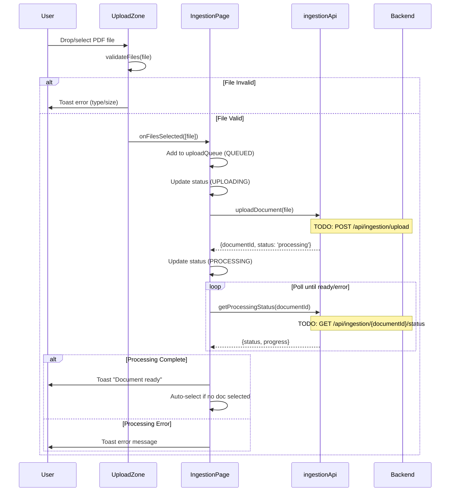
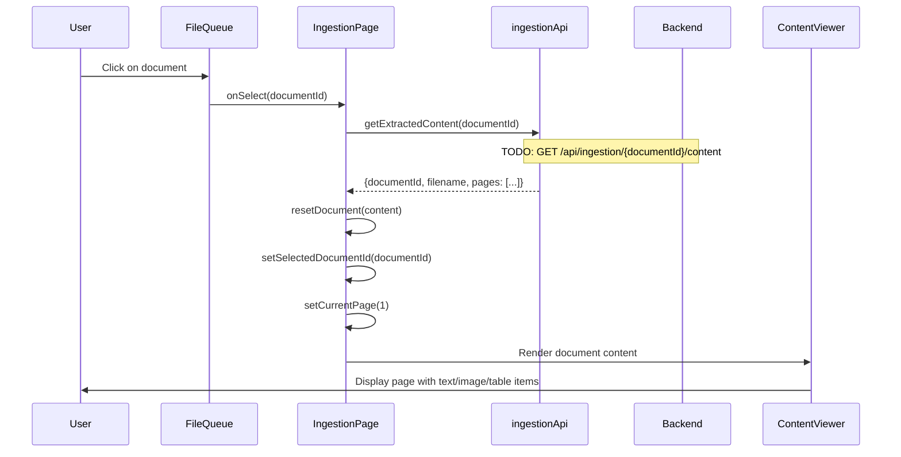
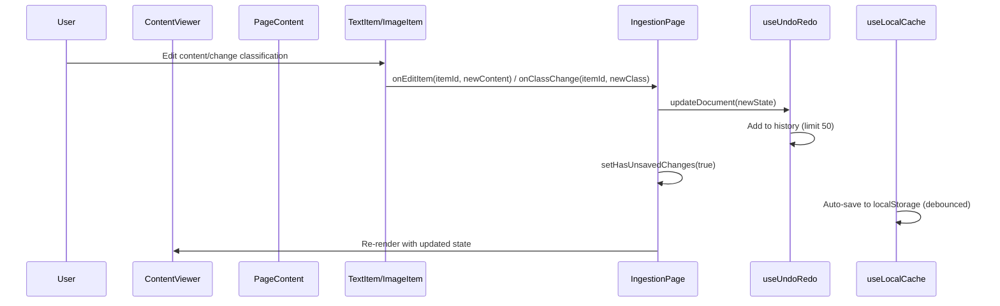
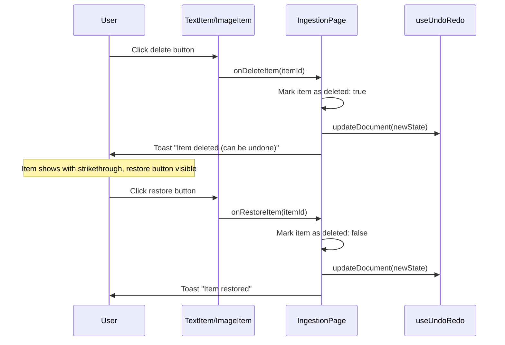
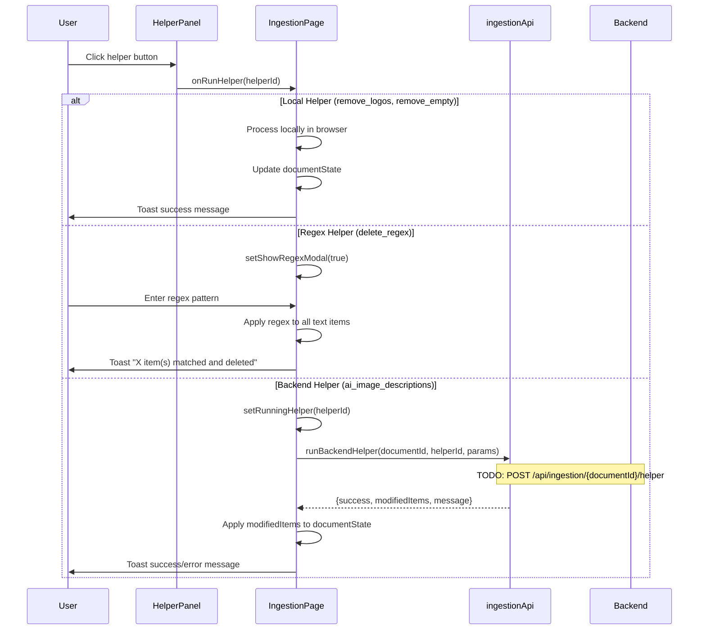
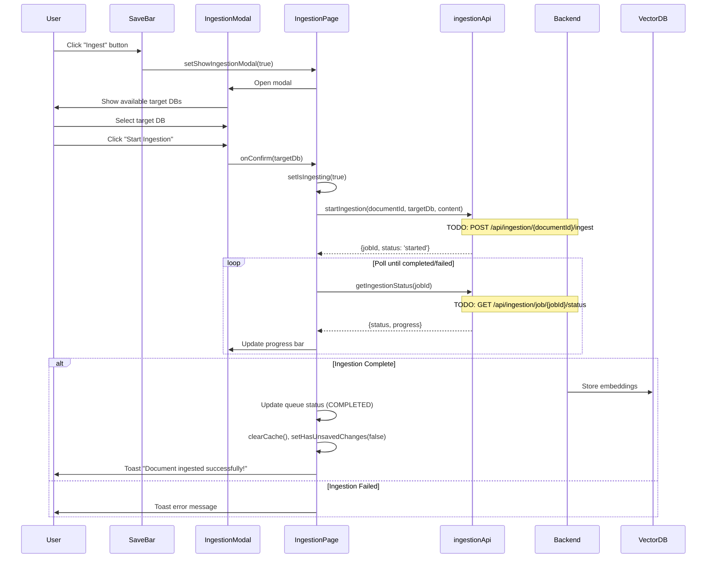
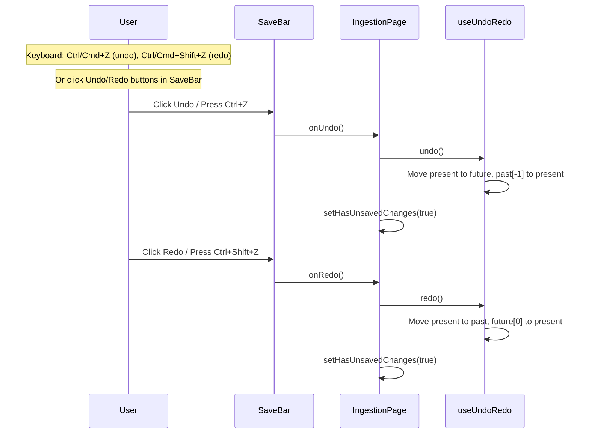
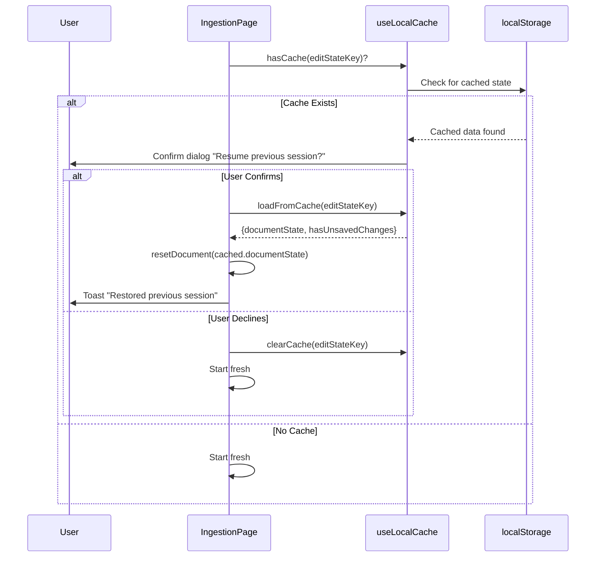

# IngestionPage Feature Documentation

## Overview

The **IngestionPage** is an admin-only page for document ingestion workflow in the ATOSS GPT application. It enables users to:
1. Upload PDF documents
2. Review and edit extracted content (text, images, tables)
3. Apply helper functions (local or AI-powered) to clean/enhance content
4. Ingest the processed content into a vector database

---

## Architecture

### Component Hierarchy

```
IngestionPage.jsx
├── UploadZone.jsx          # Drag-and-drop file upload
├── FileQueue.jsx           # List of uploaded documents
│   └── FileQueueItem.jsx   # Individual file item with status
├── ContentViewer.jsx       # Main content viewing area
│   ├── PageNavigation.jsx  # Page navigation controls
│   └── PageContent.jsx     # Page content renderer
│       ├── TextItem.jsx    # Editable text block
│       ├── ImageItem.jsx   # Image with classification dropdown
│       └── TableItem.jsx   # Table display component
├── HelperPanel.jsx         # Sidebar with helper function buttons
├── SaveBar.jsx             # Undo/redo and save controls
├── IngestionModal.jsx      # Modal for target DB selection
└── RegexInputModal.jsx     # Modal for regex pattern input
```

### Custom Hooks Used

| Hook | Purpose |
|------|---------|
| `useBackendConfig` | Fetches dynamic configuration from backend (available DBs, image classes, embedding models) |
| `useUndoRedo` | Manages document state with undo/redo history (max 50 steps) |
| `useLocalCache` | Persists edit state to localStorage for session recovery |

### Services

| Service | File | Purpose |
|---------|------|---------|
| `ingestionApi.js` | `src/services/ingestionApi.js` | All API calls for document ingestion |

### Configuration

| Config File | Purpose |
|-------------|---------|
| `ingestionConfig.js` | File upload settings, helper definitions, polling intervals, UI settings |
| `ingestionMocks.js` | Mock data for development (backend config, extracted content) |

---

## Activity-Based Sequence Diagrams

### 1. Document Upload Flow



### 2. Document Selection & Content Loading Flow



### 3. Content Editing Flow



### 4. Delete/Restore Item Flow



### 5. Helper Functions Flow



### 6. Ingestion to Vector DB Flow



### 7. Undo/Redo Flow



### 8. Session Recovery Flow



---

## Backend Integration TODOs

All backend integration points are marked with `// TODO: Connect to backend` comments in `src/services/ingestionApi.js`.

### API Endpoints Required

| # | Endpoint | Method | Purpose | Location in Code |
|---|----------|--------|---------|------------------|
| 1 | `/api/ingestion/upload` | POST | Upload PDF file for processing | `uploadDocument()` |
| 2 | `/api/ingestion/{documentId}/status` | GET | Get document processing status | `getProcessingStatus()` |
| 3 | `/api/ingestion/{documentId}/content` | GET | Get extracted content (pages, items) | `getExtractedContent()` |
| 4 | `/api/ingestion/config` | GET | Get backend configuration | `getBackendConfig()` |
| 5 | `/api/ingestion/{documentId}/helper` | POST | Run AI helper function | `runBackendHelper()` |
| 6 | `/api/ingestion/{documentId}/ingest` | POST | Start ingestion to vector DB | `startIngestion()` |
| 7 | `/api/ingestion/job/{jobId}/status` | GET | Get ingestion job status | `getIngestionStatus()` |
| 8 | `/api/ingestion/{id}` | DELETE | Cancel processing/ingestion job | `cancelJob()` |

### Detailed API Specifications

#### 1. Upload Document
```javascript
// POST /api/ingestion/upload
// Content-Type: multipart/form-data

// Request
const formData = new FormData();
formData.append('file', file);
formData.append('config', JSON.stringify({ /* optional processing config */ }));

// Response
{
    documentId: "doc_abc123",
    status: "processing",
    estimatedTime: 5000  // ms
}
```

#### 2. Get Processing Status
```javascript
// GET /api/ingestion/{documentId}/status

// Response
{
    status: "processing" | "ready" | "error",
    progress: 0-100,
    error?: "Error message if failed"
}
```

#### 3. Get Extracted Content
```javascript
// GET /api/ingestion/{documentId}/content

// Response
{
    documentId: "doc_abc123",
    filename: "document.pdf",
    totalPages: 5,
    pages: [
        {
            pageNumber: 1,
            items: [
                {
                    id: "t1",
                    type: "text",
                    content: "# Heading\n\nParagraph text...",
                    deleted: false
                },
                {
                    id: "i1",
                    type: "image",
                    imageUrl: "data:image/png;base64,...",  // or URL
                    imageWidth: 400,
                    imageHeight: 300,
                    classification: "diagram",
                    description?: "Optional AI-generated description",
                    deleted: false
                },
                {
                    id: "tb1",
                    type: "table",
                    tableData: {
                        headers: ["Col1", "Col2"],
                        rows: [["A", "B"], ["C", "D"]]
                    },
                    deleted: false
                }
            ]
        }
        // ... more pages
    ]
}
```

#### 4. Get Backend Config
```javascript
// GET /api/ingestion/config

// Response
{
    availableTargetDbs: [
        { id: "chroma_default", label: "ChromaDB (Default)" },
        { id: "chroma_snowflake", label: "ChromaDB (Snowflake)" }
    ],
    availableImageClasses: [
        "logo", "figure", "chart", "diagram", "photo", "screenshot", "table_image", "other"
    ],
    embeddingModels: [
        { id: "default", label: "Snowflake Arctic Embed", disabled: false },
        { id: "openai", label: "OpenAI Ada-002", disabled: true }
    ]
}
```

#### 5. Run Backend Helper
```javascript
// POST /api/ingestion/{documentId}/helper
// Content-Type: application/json

// Request
{
    helperId: "ai_image_descriptions",
    params: { /* helper-specific params */ }
}

// Response
{
    success: true,
    modifiedItems: [
        { id: "i1", description: "AI-generated description" },
        { id: "i2", description: "Another description" }
    ],
    message: "Generated descriptions for 2 images"
}
```

#### 6. Start Ingestion
```javascript
// POST /api/ingestion/{documentId}/ingest
// Content-Type: application/json

// Request
{
    targetDb: "chroma_default",
    content: {
        pages: [ /* modified pages with items */ ]
    }
}

// Response
{
    jobId: "job_xyz789",
    status: "started"
}
```

#### 7. Get Ingestion Status
```javascript
// GET /api/ingestion/job/{jobId}/status

// Response
{
    status: "running" | "completed" | "failed",
    progress: 0-100,
    error?: "Error message if failed"
}
```

---

## Data Structures

### Document State
```typescript
interface DocumentState {
    documentId: string;
    filename: string;
    totalPages: number;
    pages: Page[];
}

interface Page {
    pageNumber: number;
    items: (TextItem | ImageItem | TableItem)[];
}

interface TextItem {
    id: string;
    type: 'text';
    content: string;        // Markdown-formatted text
    deleted: boolean;
}

interface ImageItem {
    id: string;
    type: 'image';
    imageUrl: string;       // Base64 data URL or HTTP URL
    imageWidth: number;
    imageHeight: number;
    classification: string; // 'logo' | 'figure' | 'chart' | etc.
    description?: string;   // AI-generated or manual
    deleted: boolean;
}

interface TableItem {
    id: string;
    type: 'table';
    tableData: {
        headers: string[];
        rows: string[][];
    };
    deleted: boolean;
}
```

### Upload Queue Item
```typescript
interface QueueItem {
    id: string;             // Client-generated unique ID
    file: File;             // Original File object
    filename: string;
    documentId?: string;    // Backend-assigned after upload
    status: DOC_STATUS;     // 'queued' | 'uploading' | 'processing' | 'ready' | 'ingesting' | 'completed' | 'error'
    progress: number;       // 0-100
    error?: string;
}
```

---

## Configuration Reference

### `INGESTION_CONFIG` (ingestionConfig.js)

```javascript
{
    upload: {
        maxFileSizeMB: 10,
        allowedTypes: ['.pdf'],
        allowedMimeTypes: ['application/pdf'],
        maxConcurrentUploads: 3
    },
    image: {
        maxDisplayWidth: 400,
        maxDisplayHeight: 300,
        thumbnailSize: 150
    },
    history: {
        maxUndoSteps: 50
    },
    helpers: {
        local: [
            { id: 'remove_logos', ... },
            { id: 'remove_empty', ... },
            { id: 'delete_regex', hasInput: true, ... }
        ],
        backend: [
            { id: 'ai_image_descriptions', ... }
        ]
    },
    polling: {
        processingStatusMs: 2000,
        ingestionStatusMs: 3000
    },
    storage: {
        editStateKey: 'ingestion_edit_state',
        documentCacheKey: 'ingestion_document_cache'
    },
    ui: {
        pageNavigationDebounceMs: 100,
        autoSaveDebounceMs: 500,
        toastDurationMs: 3000
    }
}
```

---

## Authentication TODOs

Located in `IngestionPage.jsx`:

```javascript
// Line 77-91
useEffect(() => {
    const checkAuth = () => {
        // TODO: Replace with real auth when available
        const user = shouldUseMockAuth() ? mockCurrentUser : getCurrentUser();

        if (!user) {
            toast.error('Please log in to access this page');
            navigate('/');
            return;
        }

        // TODO: Enable role check when backend provides user.role
        // For now, bypass role check in development
        if (!shouldUseMockAuth() && user.role !== 'admin') {
            toast.error('Admin access required');
            navigate(-1);
            return;
        }
    };

    checkAuth();
}, [navigate]);
```

**Action Required:**
1. Ensure `getCurrentUser()` returns user object with `role` property
2. Remove `shouldUseMockAuth()` bypass for production
3. Verify admin role checking logic

---

## File Summary

| File | Lines | Purpose |
|------|-------|---------|
| `src/pages/IngestionPage.jsx` | ~607 | Main page component, state management, handlers |
| `src/services/ingestionApi.js` | ~276 | API service with mock implementations |
| `src/hooks/useBackendConfig.js` | ~61 | Backend config fetching hook |
| `src/hooks/useUndoRedo.js` | ~167 | Undo/redo state management |
| `src/hooks/useLocalCache.js` | ~200 | LocalStorage persistence |
| `src/config/ingestionConfig.js` | ~119 | Feature configuration |
| `src/mocks/ingestionMocks.js` | ~161 | Mock data for development |
| `src/components/ingestion/index.js` | ~21 | Component exports |
| `src/components/ingestion/constants.js` | ~16 | Status constants |
| `src/components/ingestion/UploadZone.jsx` | ~121 | File upload component |
| `src/components/ingestion/FileQueue.jsx` | ? | File list component |
| `src/components/ingestion/ContentViewer.jsx` | ~83 | Main content area |
| `src/components/ingestion/HelperPanel.jsx` | ~96 | Helper functions sidebar |
| `src/components/ingestion/IngestionModal.jsx` | ~144 | Target DB selection modal |
| `src/components/ingestion/RegexInputModal.jsx` | ? | Regex input modal |
| `src/components/ingestion/SaveBar.jsx` | ? | Undo/redo/save controls |
| `src/components/ingestion/PageContent.jsx` | ? | Page item renderer |
| `src/components/ingestion/PageNavigation.jsx` | ? | Page navigation |
| `src/components/ingestion/TextItem.jsx` | ? | Text editing component |
| `src/components/ingestion/ImageItem.jsx` | ? | Image display/classify component |
| `src/components/ingestion/TableItem.jsx` | ? | Table display component |

---

## Quick Reference: Where to Wire Backend

1. **`src/services/ingestionApi.js`** - All 8 API functions need real HTTP calls
2. **`src/pages/IngestionPage.jsx:77-91`** - Auth check needs real user service
3. **`src/hooks/useBackendConfig.js`** - Uses `getBackendConfig()` from ingestionApi
4. **`src/mocks/ingestionMocks.js`** - Remove/disable when backend is ready
