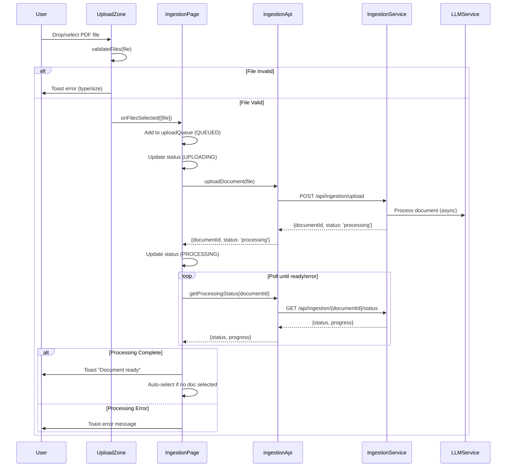
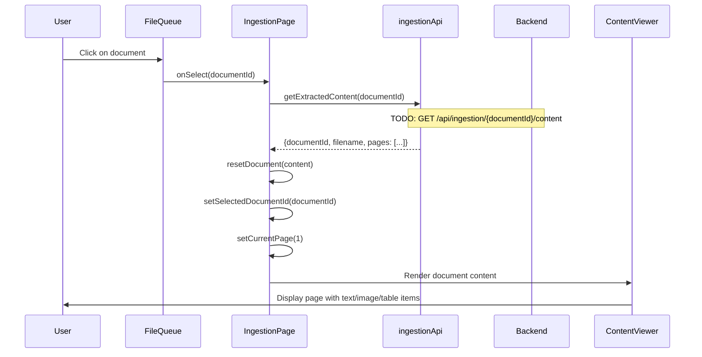
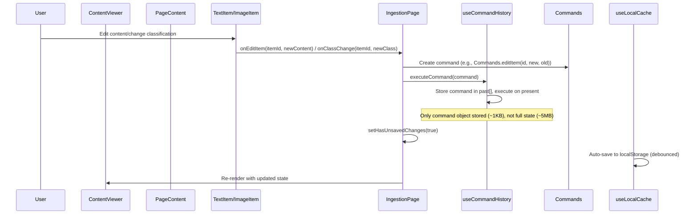
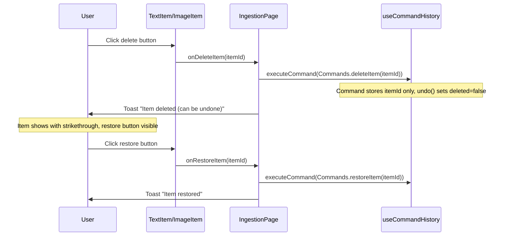
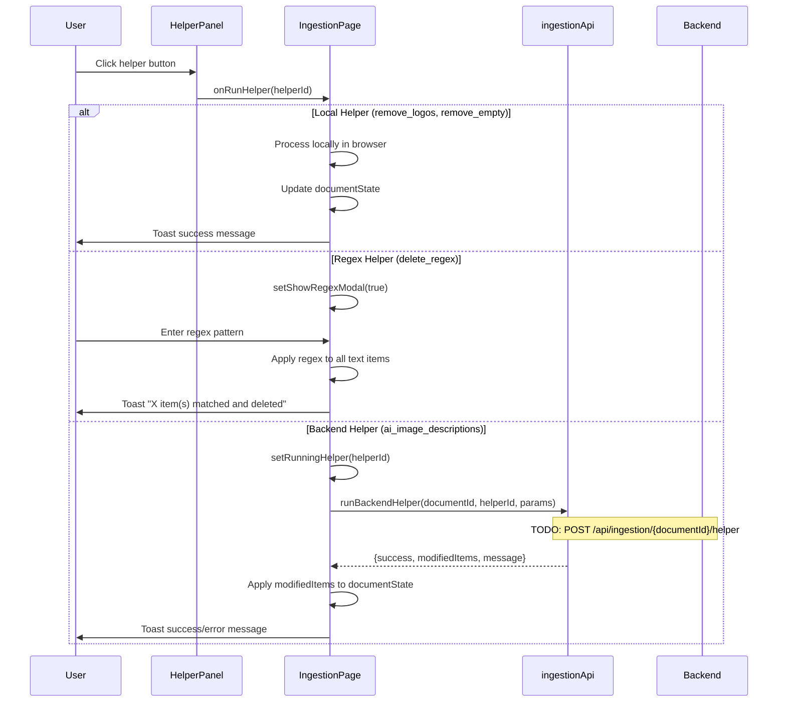
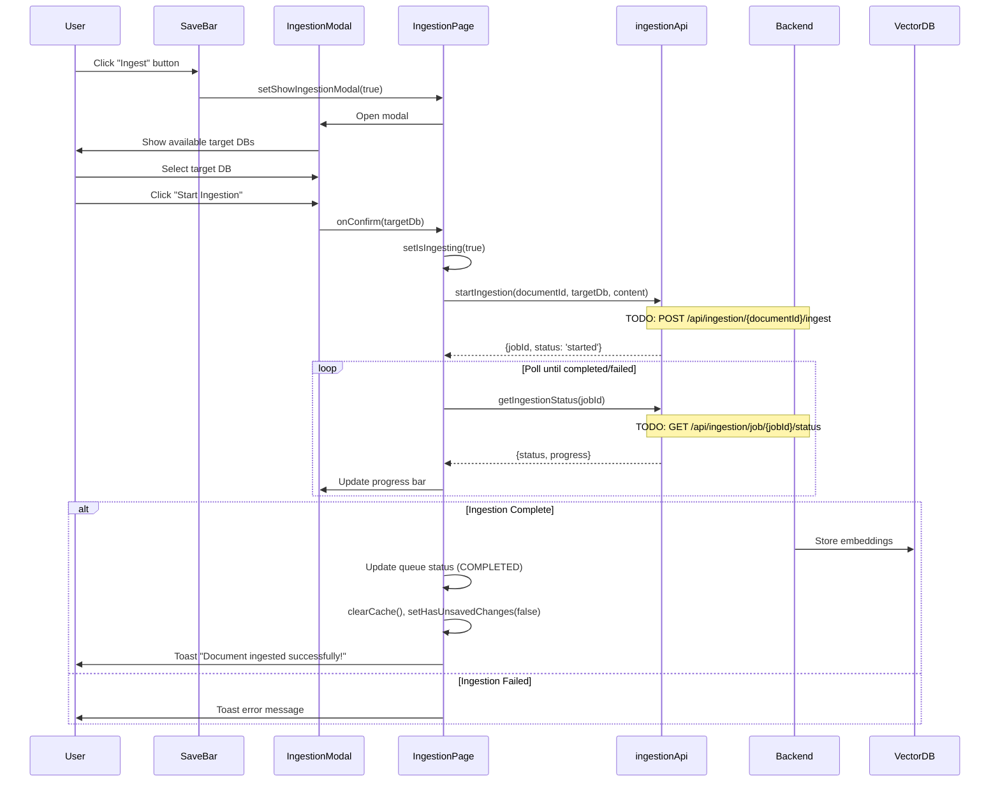
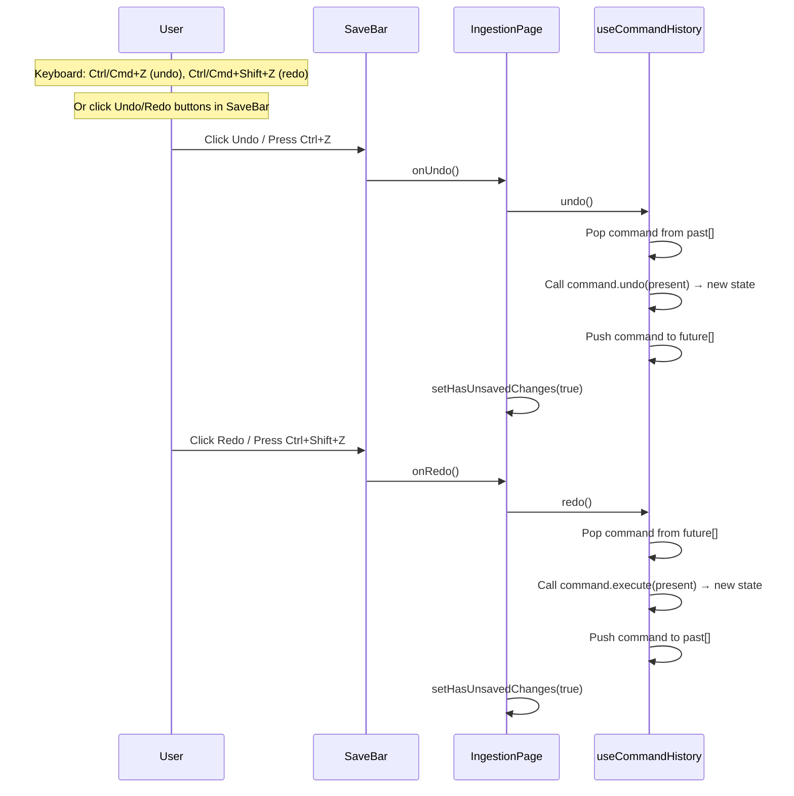
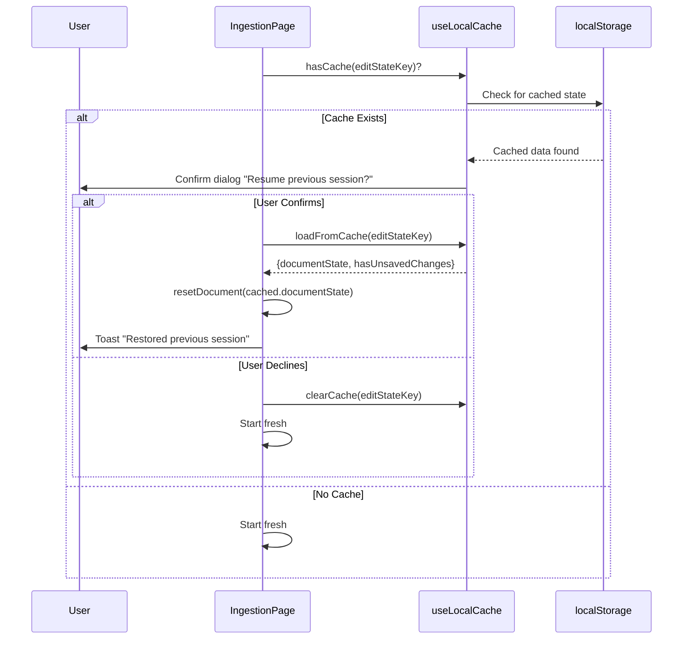

# IngestionPage Feature Documentation

## Overview

The **IngestionPage** is an admin-only page for document ingestion workflow in the ATOSS GPT application. It enables users to:
1. Upload PDF documents
2. Review and edit extracted content (text, images, tables)
3. Apply helper functions (local or AI-powered) to clean/enhance content
4. Ingest the processed content into a vector database

---

## Architecture

### Service Architecture

```
┌─────────────────────────────────────────────────────────────────────────┐
│                              Frontend                                    │
│  ┌─────────────────┐    ┌─────────────────┐    ┌─────────────────────┐ │
│  │ IngestionPage   │───▶│ ingestionApi.js │───▶│ HTTP Requests       │ │
│  │ (React)         │    │ (Service Layer) │    │                     │ │
│  └─────────────────┘    └─────────────────┘    └──────────┬──────────┘ │
└──────────────────────────────────────────────────────────┼──────────────┘
                                                           │
                           ┌───────────────────────────────▼──────────────┐
                           │           Ingestion Service (Node.js)        │
                           │           Port 4005 - Proxy/Mock             │
                           │  ┌─────────────────────────────────────────┐ │
                           │  │ ingestionService.js                     │ │
                           │  │ - getConfig()        [MOCK]             │ │
                           │  │ - uploadForProcessing() [MOCK]          │ │
                           │  │ - ingestToVectorDb() [MOCK]             │ │
                           │  │ - generateEmbeddingPreview() [LOCAL]    │ │
                           │  └─────────────────────────────────────────┘ │
                           │  ┌─────────────────────────────────────────┐ │
                           │  │ contentViewerService.js                 │ │
                           │  │ - runAiHelper()      [MOCK]             │ │
                           │  └─────────────────────────────────────────┘ │
                           └───────────────────────────────┬──────────────┘
                                                           │
                                                           │ [NOT IMPLEMENTED]
                                                           ▼
                           ┌──────────────────────────────────────────────┐
                           │           LLM Service (FastAPI)              │
                           │           Port 8000                          │
                           │  ┌─────────────────────────────────────────┐ │
                           │  │ TODO: Endpoints to implement            │ │
                           │  │ - GET  /api/config                      │ │
                           │  │ - POST /api/docling/process             │ │
                           │  │ - POST /api/ingest                      │ │
                           │  │ - POST /api/helper/{helperId}           │ │
                           │  └─────────────────────────────────────────┘ │
                           └──────────────────────────────────────────────┘
```

### Current Implementation Status

| Layer | Status | Notes |
|-------|--------|-------|
| Frontend (IngestionPage) | ✅ Implemented | Full UI with editing, preview, ingestion |
| Frontend (ingestionApi.js) | ✅ Implemented | Calls Ingestion Service |
| Ingestion Service (Node.js) | ✅ Proxy/Mock | Returns mock data, ready for LLM integration |
| LLM Service (FastAPI) | ❌ Not Implemented | Endpoints need to be created |

### Component Hierarchy

```
IngestionPage.jsx
├── UploadZone.jsx          # Drag-and-drop file upload
├── FileQueue.jsx           # List of uploaded documents
│   └── FileQueueItem.jsx   # Individual file item with status
├── ContentViewer.jsx       # Main content viewing area
│   ├── PageNavigation.jsx  # Page navigation controls
│   └── PageContent.jsx     # Page content renderer
│       ├── TextItem.jsx    # Editable text block
│       ├── ImageItem.jsx   # Image with classification dropdown
│       └── TableItem.jsx   # Table display component
├── HelperPanel.jsx         # Sidebar with helper function buttons
├── SaveBar.jsx             # Undo/redo and save controls
├── IngestionModal.jsx      # Modal for target DB selection
└── RegexInputModal.jsx     # Modal for regex pattern input
```

### Custom Hooks Used

| Hook | Purpose |
|------|---------|
| `useBackendConfig` | Fetches dynamic configuration from backend (available DBs, image classes, embedding models) |
| `useCommandHistory` | Command Pattern undo/redo - stores lightweight commands instead of full state copies (memory efficient for large documents) |
| `useLocalCache` | Persists edit state to localStorage for session recovery |

### Services

| Service | File | Purpose |
|---------|------|---------|
| `ingestionApi.js` | `src/services/ingestionApi.js` | All API calls for document ingestion |

### Configuration

| Config File | Purpose |
|-------------|---------|
| `ingestionConfig.js` | File upload settings, helper definitions, polling intervals, UI settings |
| `ingestionMocks.js` | Mock data for development (replaced by backend in production) |

### Backend Services

| Service | Directory | Port | Purpose | Status |
|---------|-----------|------|---------|--------|
| `ingestion` | `backend/ingestion/` | 4005 | Document upload, processing status, content management | ✅ Mock data |
| `llm` | `backend/llm/` | 8000 | Document processing, embedding generation | ❌ Not implemented |

### ADR Decisions Applied

This feature follows architectural decisions documented in `doc/ingestion/ADR.md`:

- **ADR-001: Strategy and Helper Code Location** - Hybrid approach where backend provides metadata/control and frontend provides local execution code. Config endpoint returns `strategies` and `helpers` arrays with `type: 'local'|'backend'` flags.

- **ADR-002: Component State Management** (Planned) - Context + Reducer with Split Contexts for scalable state management.

---

## Activity-Based Sequence Diagrams

### 1. Document Upload Flow



### 2. Document Selection & Content Loading Flow



### 3. Content Editing Flow



### 4. Delete/Restore Item Flow



### 5. Helper Functions Flow



### 6. Ingestion to Vector DB Flow



### 7. Undo/Redo Flow (Command Pattern)

The undo/redo system uses the **Command Pattern** for memory efficiency. Instead of storing full document snapshots (~5MB each), it stores lightweight command objects (~1KB each).

**Memory Comparison:**
| Approach | 5MB doc, 50 undo steps |
|----------|------------------------|
| Full Snapshots (old) | ~250MB |
| Command Pattern (new) | ~5MB + ~50KB |



**Available Commands:**
| Command | Usage | Stored Data |
|---------|-------|-------------|
| `Commands.editItem(id, new, old)` | Text content edit | itemId, newContent, oldContent |
| `Commands.deleteItem(id)` | Soft delete | itemId only |
| `Commands.restoreItem(id)` | Restore deleted | itemId only |
| `Commands.changeClass(id, new, old)` | Image classification | itemId, newClass, oldClass |
| `Commands.batchDelete(ids)` | Helper: remove logos/empty | Array of itemIds |
| `Commands.batchUpdate(changes)` | AI helper results | Array of {itemId, newValues, oldValues} |
| `Commands.renameDocument(new, old)` | Rename file | newFilename, oldFilename |

### 8. Session Recovery Flow



---

## Backend Integration

The Ingestion Service (`backend/ingestion/`) acts as a **proxy** between the frontend and the LLM Service. Currently, it returns **mock data** because the LLM Service endpoints are not yet implemented.

### API Endpoints (Ingestion Service)

| # | Endpoint | Method | Purpose | Implementation |
|---|----------|--------|---------|----------------|
| 1 | `/api/ingestion/config` | GET | Get backend configuration (ADR-001 hybrid config) | ✅ Mock data |
| 2 | `/api/ingestion/upload` | POST | Upload PDF file for content extraction | ✅ Mock data |
| 3 | `/api/ingestion/preview` | POST | Generate embedding preview from document state | ✅ Local (no LLM needed) |
| 4 | `/api/ingestion/ingest` | POST | Ingest document into vector database | ✅ Mock success |
| 5 | `/api/ingestion/helper` | POST | Run AI helper function | ✅ Mock data |

### API Specifications

#### 1. Get Configuration (ADR-001 Hybrid Config)
```javascript
// GET /api/ingestion/config
// Returns metadata that controls frontend behavior

// Response
{
    // Embedding strategies - controls frontend dropdown
    strategies: [
        { id: 'embed_per_page', label: 'One Embedding per Page', type: 'local', enabled: true },
        { id: 'chunked_fixed', label: 'Fixed-Size Chunks', type: 'local', enabled: true },
        { id: 'semantic_sections', label: 'Semantic Sections (AI)', type: 'backend', enabled: false },
        { id: 'hierarchical', label: 'Hierarchical (AI)', type: 'backend', enabled: false },
    ],
    // Helper functions - controls helper panel buttons
    helpers: [
        { id: 'remove_logos', label: 'Remove All Logos', type: 'local', enabled: true },
        { id: 'remove_empty', label: 'Remove Empty Text', type: 'local', enabled: true },
        { id: 'delete_regex', label: 'Delete by Regex', type: 'local', enabled: true, hasInput: true },
        { id: 'ai_image_descriptions', label: 'AI Image Descriptions', type: 'backend', enabled: false },
    ],
    // Target databases
    collections: [
        { id: 'chroma_default', label: 'ChromaDB (Default)' },
        { id: 'chroma_snowflake', label: 'ChromaDB (Snowflake Collection)' },
    ],
    // Image classification options
    imageClasses: ['logo', 'figure', 'chart', 'diagram', 'photo', 'screenshot', 'table_image', 'other'],
    // Embedding models
    embeddingModels: [
        { id: 'default', label: 'Snowflake Arctic Embed', disabled: false },
        { id: 'openai', label: 'OpenAI Ada-002', disabled: true },
    ],
}
```

#### 2. Upload Document
```javascript
// POST /api/ingestion/upload
// Content-Type: multipart/form-data

// Request
const formData = new FormData();
formData.append('file', file);

// Response (currently MOCK data)
{
    success: true,
    filename: "document.pdf",
    content: {
        documentId: "doc_1706428800000",
        filename: "document.pdf",
        totalPages: 3,
        pages: [
            {
                pageNumber: 1,
                items: [
                    { id: "t1", type: "text", content: "# Chapter 1...", deleted: false },
                    { id: "i1", type: "image", imageUrl: "data:...", classification: "logo", deleted: false },
                    // ...
                ]
            },
            // ...more pages
        ]
    }
}
```

#### 3. Preview Embeddings
```javascript
// POST /api/ingestion/preview
// This endpoint runs LOCAL logic (no LLM service call needed)

// Request
{
    strategy: "embed_per_page",
    documentState: { /* full document state */ }
}

// Response
{
    source: "document.pdf",
    document_type: "pdf",
    page_count: 3,
    total_embeddings: 3,
    strategy: "embed_per_page",
    documents: [
        {
            id: "page_1",
            content: "Text content from page 1...",
            metadata: {
                page_num: 1,
                source: "document.pdf",
                char_count: 500,
                word_count: 100,
            }
        },
        // ...
    ]
}
```

#### 4. Ingest to Vector DB
```javascript
// POST /api/ingestion/ingest

// Request
{
    targetDb: "chroma_default",
    documentState: { /* full document state */ },
    strategy: "embed_per_page"
}

// Response (currently MOCK success)
{
    success: true,
    targetDb: "chroma_default",
    strategy: "embed_per_page",
    documentCount: 3,
    message: "[MOCK] Successfully ingested 3 embeddings to chroma_default"
}
```

#### 5. Run AI Helper
```javascript
// POST /api/ingestion/helper

// Request
{
    helperId: "ai_image_descriptions",
    content: { pages: [...] },
    params: {}
}

// Response (currently MOCK data)
{
    success: true,
    modifiedItems: [
        { id: "i1", description: "AI-generated description for logo on page 1" },
        { id: "i2", description: "AI-generated description for diagram on page 2" }
    ],
    message: "Generated descriptions for 2 images"
}
```

### LLM Service Integration (TODO)

When implementing the LLM Service endpoints, the Ingestion Service will proxy requests:

| Ingestion Service | LLM Service (TODO) |
|-------------------|-------------------|
| `GET /api/ingestion/config` | `GET /api/config` |
| `POST /api/ingestion/upload` | `POST /api/docling/process` |
| `POST /api/ingestion/ingest` | `POST /api/ingest` |
| `POST /api/ingestion/helper` | `POST /api/helper/{helperId}` |

---

## Data Structures

### Document State
```typescript
interface DocumentState {
    documentId: string;
    filename: string;
    totalPages: number;
    pages: Page[];
}

interface Page {
    pageNumber: number;
    items: (TextItem | ImageItem | TableItem)[];
}

interface TextItem {
    id: string;
    type: 'text';
    content: string;        // Markdown-formatted text
    deleted: boolean;
}

interface ImageItem {
    id: string;
    type: 'image';
    imageUrl: string;       // Base64 data URL or HTTP URL
    imageWidth: number;
    imageHeight: number;
    classification: string; // 'logo' | 'figure' | 'chart' | etc.
    description?: string;   // AI-generated or manual
    deleted: boolean;
}

interface TableItem {
    id: string;
    type: 'table';
    tableData: {
        headers: string[];
        rows: string[][];
    };
    deleted: boolean;
}
```

### Upload Queue Item
```typescript
interface QueueItem {
    id: string;             // Client-generated unique ID
    file: File;             // Original File object
    filename: string;
    documentId?: string;    // Backend-assigned after upload
    status: DOC_STATUS;     // 'queued' | 'uploading' | 'processing' | 'ready' | 'ingesting' | 'completed' | 'error'
    progress: number;       // 0-100
    error?: string;
}
```

---

## Configuration Reference

### `INGESTION_CONFIG` (ingestionConfig.js)

```javascript
{
    upload: {
        maxFileSizeMB: 10,
        allowedTypes: ['.pdf'],
        allowedMimeTypes: ['application/pdf'],
        maxConcurrentUploads: 3
    },
    image: {
        maxDisplayWidth: 400,
        maxDisplayHeight: 300,
        thumbnailSize: 150
    },
    history: {
        maxUndoSteps: 50
    },
    helpers: {
        local: [
            { id: 'remove_logos', ... },
            { id: 'remove_empty', ... },
            { id: 'delete_regex', hasInput: true, ... }
        ],
        backend: [
            { id: 'ai_image_descriptions', ... }
        ]
    },
    polling: {
        processingStatusMs: 2000,
        ingestionStatusMs: 3000
    },
    storage: {
        editStateKey: 'ingestion_edit_state',
        documentCacheKey: 'ingestion_document_cache'
    },
    ui: {
        pageNavigationDebounceMs: 100,
        autoSaveDebounceMs: 500,
        toastDurationMs: 3000
    }
}
```

---

## Authentication TODOs

Located in `IngestionPage.jsx`:

```javascript
// Line 77-91
useEffect(() => {
    const checkAuth = () => {
        // TODO: Replace with real auth when available
        const user = shouldUseMockAuth() ? mockCurrentUser : getCurrentUser();

        if (!user) {
            toast.error('Please log in to access this page');
            navigate('/');
            return;
        }

        // TODO: Enable role check when backend provides user.role
        // For now, bypass role check in development
        if (!shouldUseMockAuth() && user.role !== 'admin') {
            toast.error('Admin access required');
            navigate(-1);
            return;
        }
    };

    checkAuth();
}, [navigate]);
```

**Action Required:**
1. Ensure `getCurrentUser()` returns user object with `role` property
2. Remove `shouldUseMockAuth()` bypass for production
3. Verify admin role checking logic

---

## File Summary

| File | Lines | Purpose |
|------|-------|---------|
| `src/pages/IngestionPage.jsx` | ~607 | Main page component, state management, handlers |
| `src/services/ingestionApi.js` | ~276 | API service with mock implementations |
| `src/hooks/useBackendConfig.js` | ~61 | Backend config fetching hook |
| `src/hooks/useCommandHistory.js` | ~280 | Command Pattern undo/redo (memory efficient) |
| `src/hooks/useLocalCache.js` | ~200 | LocalStorage persistence |
| `src/hooks/useLocalCache.js` | ~200 | LocalStorage persistence |
| `src/config/ingestionConfig.js` | ~119 | Feature configuration |
| `src/mocks/ingestionMocks.js` | ~161 | Mock data for development |
| `src/components/ingestion/index.js` | ~21 | Component exports |
| `src/components/ingestion/constants.js` | ~16 | Status constants |
| `src/components/ingestion/UploadZone.jsx` | ~121 | File upload component |
| `src/components/ingestion/FileQueue.jsx` | ? | File list component |
| `src/components/ingestion/ContentViewer.jsx` | ~83 | Main content area |
| `src/components/ingestion/HelperPanel.jsx` | ~96 | Helper functions sidebar |
| `src/components/ingestion/IngestionModal.jsx` | ~144 | Target DB selection modal |
| `src/components/ingestion/RegexInputModal.jsx` | ? | Regex input modal |
| `src/components/ingestion/SaveBar.jsx` | ? | Undo/redo/save controls |
| `src/components/ingestion/PageContent.jsx` | ? | Page item renderer |
| `src/components/ingestion/PageNavigation.jsx` | ? | Page navigation |
| `src/components/ingestion/TextItem.jsx` | ? | Text editing component |
| `src/components/ingestion/ImageItem.jsx` | ? | Image display/classify component |
| `src/components/ingestion/TableItem.jsx` | ? | Table display component |

---

## Quick Reference: Next Steps

### To Enable Real LLM Service Integration

1. **Implement LLM Service endpoints** in `backend/llm/`:
   - `GET /api/config` - Return configuration
   - `POST /api/docling/process` - PDF content extraction
   - `POST /api/ingest` - Vector DB ingestion
   - `POST /api/helper/{helperId}` - AI helpers

2. **Uncomment proxy code** in Ingestion Service:
   - `backend/ingestion/services/ingestionService.js` - Uncomment axios calls
   - `backend/ingestion/services/contentViewerService.js` - Uncomment axios calls

3. **Update config** to enable backend features:
   - Set `enabled: true` for backend strategies/helpers in `getDefaultConfig()`

### Authentication TODOs

Located in `IngestionPage.jsx`:
- Ensure `getCurrentUser()` returns user object with `role` property
- Remove `shouldUseMockAuth()` bypass for production
- Verify admin role checking logic
