# Ingestion Page UI Components Documentation

> **Last Updated**: 2026-01-29 (Multi-file ingestion, preview switching, cache clearing)

## Table of Contents
1. [Architecture Overview](#architecture-overview)
2. [Component Hierarchy](#component-hierarchy)
3. [State Management](#state-management)
4. [User Interaction Modes](#user-interaction-modes)
5. [Backend API Triggers](#backend-api-triggers)
6. [Component Reference](#component-reference)
7. [Data Flow Diagrams](#data-flow-diagrams)

---

## Architecture Overview

The Ingestion Page is a document processing and vector database ingestion UI that follows these principles:

- **Stateless Backend**: All document state lives in `localStorage`
- **Command Pattern**: Undo/redo via `useCommandHistory` hook
- **Cache Persistence**: `useLocalCache` + `fileCacheManager.js` for session recovery
- **Three-panel Layout**: Left sidebar (files), Main area (content), Right sidebar (helpers)

```
┌─────────────────────────────────────────────────────────────────────┐
│                        IngestionPage.jsx                            │
├─────────────┬───────────────────────────────────┬───────────────────┤
│   Left      │                                   │      Right        │
│  Sidebar    │        Main Content Area          │     Sidebar       │
│             │                                   │                   │
│ ┌─────────┐ │  ┌─────────────────────────────┐  │  ┌─────────────┐  │
│ │Upload   │ │  │   Header / SaveBar          │  │  │HelperPanel  │  │
│ │Zone     │ │  └─────────────────────────────┘  │  │             │  │
│ └─────────┘ │  ┌─────────────────────────────┐  │  │ • Remove    │  │
│ ┌─────────┐ │  │                             │  │  │   Logos     │  │
│ │File     │ │  │   ContentViewer             │  │  │ • Remove    │  │
│ │Queue    │ │  │   ├─ PageContent            │  │  │   Empty     │  │
│ │         │ │  │   │  ├─ TextItem            │  │  │ • Regex Del │  │
│ │ • File1 │ │  │   │  ├─ ImageItem           │  │  │ • AI Image  │  │
│ │ • File2 │ │  │   │  └─ TableItem           │  │  │   Desc      │  │
│ │ • ...   │ │  │   └─ PageNavigation         │  │  └─────────────┘  │
│ └─────────┘ │  │                             │  │                   │
│             │  └─────────────────────────────┘  │                   │
└─────────────┴───────────────────────────────────┴───────────────────┘
```

---

## Component Hierarchy

### Architecture (Connected Components)

```
IngestionPage.jsx (entry point)
└── IngestionProvider (context provider)
    └── IngestionPage (~550 lines - layout-only)
        ├── ConnectedUploadZone.jsx      - Drag-drop upload (owns upload logic)
        ├── ConnectedFileQueue.jsx       - File list (owns selection logic)
        │   └── FileQueueItem.jsx        - Individual file item (pure UI)
        ├── ConnectedContentViewer.jsx   - Main content display (owns edit logic)
        │   ├── PageContent.jsx          - Page items container (pure UI)
        │   │   ├── TextItem.jsx         - Editable text (pure UI)
        │   │   ├── ImageItem.jsx        - Image with classification (pure UI)
        │   │   └── TableItem.jsx        - Read-only table (pure UI)
        │   └── PageNavigation.jsx       - Page nav buttons (pure UI)
        ├── ConnectedHelperPanel.jsx     - AI helper functions (owns execution logic)
        ├── EmbeddingPreviewViewer.jsx   - Preview before ingestion (pure UI)
        │   └── EmbeddingPreview.jsx     - Single embedding card (pure UI)
        ├── IngestionModal.jsx           - Strategy/DB selection (pure UI)
        ├── RegexInputModal.jsx          - Regex pattern input (pure UI)
        ├── CacheManagement.jsx          - Cache clearing UI (pure UI)
        └── HelperFileSelectModal.jsx    - Multi-file helper selection (pure UI)
```

### Component Classification

| Type | Components | Characteristics |
|------|------------|-----------------|
| **Connected** | `ConnectedUploadZone`, `ConnectedFileQueue`, `ConnectedContentViewer`, `ConnectedHelperPanel` | Use context hooks, own business logic, dispatch actions |
| **Pure UI** | `FileQueueItem`, `PageContent`, `TextItem`, `ImageItem`, `TableItem`, `PageNavigation`, Modals | Receive props, emit events, no context dependency |

### Constants (`constants.js`)
```javascript
// Document Status Lifecycle
export const DOC_STATUS = {
    QUEUED: 'queued',       // File selected, waiting to upload
    UPLOADING: 'uploading', // Currently uploading
    PROCESSING: 'processing', // Backend processing (PDF→JSON)
    READY: 'ready',         // Ready for editing
    INGESTING: 'ingesting', // Being ingested to vector DB
    COMPLETED: 'completed', // Ingestion complete
    INGESTED: 'ingested',   // In ingested files section
    ERROR: 'error',         // Upload/processing failed
};

// Content View Modes
export const CONTENT_TYPE = {
    EDITOR: 'editor',       // Edit mode (pages/items)
    EMBEDDING: 'embedding', // View stored embeddings
};
```

---

## State Management

### State Categories in IngestionPage.jsx

#### 1. Upload Queue State
| State | Type | Purpose |
|-------|------|---------|
| `uploadQueue` | Array | List of files with `{documentId, filename, status}` |
| `selectedDocumentId` | string | Currently selected file ID |
| `isDragging` | boolean | Drag-over visual state |

#### 2. Document Content State
| State | Type | Purpose |
|-------|------|---------|
| `documentState` | Object | Current document `{filename, pages: [{pageNumber, items}]}` |
| `currentPage` | number | Active page number (1-indexed) |
| `hasUnsavedChanges` | boolean | Dirty flag for save prompt |
| `isEditingTitle` | boolean | Title edit mode active |
| `editingTitleValue` | string | Temp title value during edit |

#### 3. UI Panel State
| State | Type | Purpose |
|-------|------|---------|
| `leftSidebarCollapsed` | boolean | File queue collapsed |
| `rightSidebarCollapsed` | boolean | Helpers collapsed |
| `rightSidebarStateBeforePreview` | boolean | Saved state for preview mode |

#### 4. Preview & Ingestion State
| State | Type | Purpose |
|-------|------|---------|
| `isPreviewMode` | boolean | Showing embedding preview |
| `isLoadingPreview` | boolean | Generating preview |
| `embeddingPreview` | Object | Preview data `{chunks: [...]}` |
| `previewConfig` | Object | `{targetDb, strategy}` |
| `previewDocumentIds` | Set | Files in multi-file preview |
| `isIngesting` | boolean | Ingestion in progress |
| `ingestionProgress` | number | 0-100 progress |

#### 5. Multi-Select State
| State | Type | Purpose |
|-------|------|---------|
| `multiSelectMode` | boolean | Multi-select toggle |
| `checkedDocumentIds` | Set | Selected file IDs |

#### 6. Helper State
| State | Type | Purpose |
|-------|------|---------|
| `runningHelper` | string | Currently running helper ID |
| `pendingHelper` | Object | Helper awaiting file selection |
| `showHelperFileModal` | boolean | File selection modal open |
| `showRegexModal` | boolean | Regex input modal open |

#### 7. Modal State
| State | Type | Purpose |
|-------|------|---------|
| `showIngestionModal` | boolean | Ingestion config modal |
| `showCacheManagement` | boolean | Cache management modal |

#### 8. Content Type State
| State | Type | Purpose |
|-------|------|---------|
| `contentType` | CONTENT_TYPE | EDITOR or EMBEDDING |
| `storedEmbeddings` | Object | Cached embeddings for ingested file |
| `ingestedFilesList` | Array | List from localStorage |

### Hooks Used

| Hook | Source | Purpose |
|------|--------|---------|
| `useCommandHistory` | Custom | Undo/redo with command pattern |
| `useLocalCache` | Custom | localStorage persistence |
| `useBackendConfig` | Custom | Fetch backend config on mount |
| `useFileQueue` | Context | Access file queue state |
| `useDocument` | Context | Access document state |
| `usePreview` | Context | Access preview state |
| `useUI` | Context | Access UI state |
| `useIngestionActions` | Context | Dispatch actions to reducer |

---

## State Management Architecture (ADR-002)

> **ADR-002**: Components communicate via Context + Reducer with Split Contexts.
> See `doc/ingestion/ADR.md` for the full decision record.

### Core Principle

State is managed by a **single reducer** (`ingestionReducer.js`) for traceability, split into **four domains** with separate React contexts for fine-grained re-renders.

### How State Changes Propagate (The Notification Mechanism)

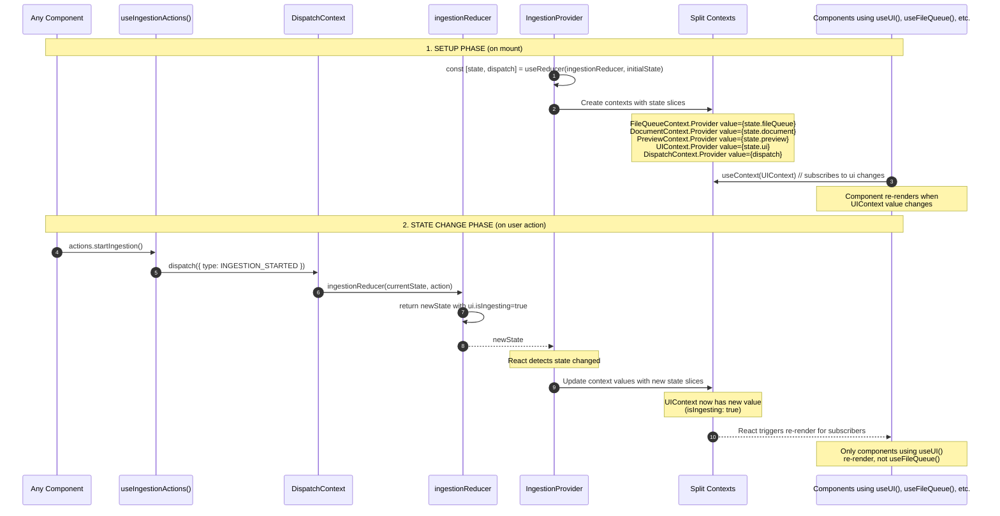

### The Key Files Explained

```
┌─────────────────────────────────────────────────────────────────────────┐
│  contexts.js - Creates empty contexts                                   │
│  ─────────────────────────────────────────────────────────────────────  │
│  export const UIContext = createContext(null);                          │
│  export const FileQueueContext = createContext(null);                   │
│  // ... contexts are just "buckets" to hold values                      │
└─────────────────────────────────────────────────────────────────────────┘
                                    │
                                    ▼
┌─────────────────────────────────────────────────────────────────────────┐
│  IngestionProvider.jsx - Connects reducer to contexts                   │
│  ─────────────────────────────────────────────────────────────────────  │
│  function IngestionProvider({ children }) {                             │
│    const [state, dispatch] = useReducer(ingestionReducer, initialState);│
│                                                                         │
│    return (                                                             │
│      <DispatchContext.Provider value={dispatch}>      ← stable ref      │
│        <FileQueueContext.Provider value={state.fileQueue}>              │
│          <DocumentContext.Provider value={state.document}>              │
│            <PreviewContext.Provider value={state.preview}>              │
│              <UIContext.Provider value={state.ui}>    ← changes here    │
│                {children}                               trigger re-render│
│              </UIContext.Provider>                      for useUI() only │
│            </PreviewContext.Provider>                                   │
│          </DocumentContext.Provider>                                    │
│        </FileQueueContext.Provider>                                     │
│      </DispatchContext.Provider>                                        │
│    );                                                                   │
│  }                                                                      │
└─────────────────────────────────────────────────────────────────────────┘
                                    │
                                    ▼
┌─────────────────────────────────────────────────────────────────────────┐
│  hooks.js - Convenient access to contexts                               │
│  ─────────────────────────────────────────────────────────────────────  │
│  export function useUI() {                                              │
│    const context = useContext(UIContext);  // ← subscribes to UIContext │
│    return context;  // { isIngesting, activeModal, ... }                │
│  }                                                                      │
│                                                                         │
│  export function useIngestionActions() {                                │
│    const dispatch = useContext(DispatchContext);  // ← stable, no rerenders│
│    return useMemo(() => ({                                              │
│      startIngestion: () => dispatch({ type: INGESTION_STARTED }),       │
│      // ... all action creators                                         │
│    }), [dispatch]);                                                     │
│  }                                                                      │
└─────────────────────────────────────────────────────────────────────────┘
```

### Why Split Contexts?

Without split contexts, ANY state change would re-render ALL components:

```javascript
// ❌ BAD: Single context - everything re-renders on any change
<IngestionContext.Provider value={entireState}>

// ✅ GOOD: Split contexts - only relevant components re-render
<UIContext.Provider value={state.ui}>           // Only useUI() subscribers
<FileQueueContext.Provider value={state.fileQueue}>  // Only useFileQueue() subscribers
```

### Summary: How useUI() Gets Notified

1. **Component calls `useUI()`** → internally calls `useContext(UIContext)`
2. **React subscribes** that component to `UIContext`
3. **Somewhere else**, a component calls `actions.startIngestion()`
4. **dispatch()** sends action to reducer
5. **Reducer** returns new state with `ui.isIngesting = true`
6. **IngestionProvider** re-renders, passes new `state.ui` to `UIContext.Provider`
7. **React detects** `UIContext` value changed
8. **All components using `useUI()`** re-render automatically

---

## Trigger Types: User Interaction vs State Change

Flows can be triggered in two ways:

### 🖱️ User Interaction Triggers
Direct user action (click, drop, type) starts the flow.

### ⚡ State Change Triggers (useEffect)
A `useEffect` watches for state changes and triggers the flow automatically.

```
┌─────────────────────────────────────────────────────────────────────────┐
│                     TRIGGER TYPE LEGEND                                 │
├─────────────────────────────────────────────────────────────────────────┤
│  🖱️  = User Interaction (onClick, onDrop, onSubmit)                    │
│  ⚡  = State Change (useEffect watching state)                          │
│  🔄  = Combination (user triggers, then useEffect continues)            │
└─────────────────────────────────────────────────────────────────────────┘
```

```
┌─────────────────────────────────────────────────────────────────┐
│                       IngestionProvider                         │
│  ┌───────────────────────────────────────────────────────────┐  │
│  │                       useReducer                           │  │
│  │  ┌────────────┬────────────┬────────────┬────────────┐    │  │
│  │  │ fileQueue  │  document  │  preview   │     ui     │    │  │
│  │  └────────────┴────────────┴────────────┴────────────┘    │  │
│  └───────────────────────────────────────────────────────────┘  │
│                              │                                  │
│        ┌─────────────────────┼─────────────────────┐           │
│        │                     │                     │           │
│        ▼                     ▼                     ▼           │
│  FileQueueContext      DocumentContext       PreviewContext    │
│        │                     │                     │           │
│        ▼                     ▼                     ▼           │
│   useFileQueue()       useDocument()         usePreview()      │
│                                                                │
│                     UIContext ──► useUI()                      │
│                     DispatchContext ──► useDispatch()          │
└────────────────────────────────────────────────────────────────┘
```

### Connected Components Pattern

Each **Connected Component** owns its business logic:
1. **Subscribes to context** via domain hooks (`useFileQueue`, `useDocument`, etc.)
2. **Dispatches actions** to the reducer for state changes
3. **Handles side effects** (API calls, toast notifications, caching)

### Data Flow Example: "Confirm & Ingest"

```
User clicks "Confirm & Ingest"
           │
           ▼
┌────────────────────────────────────────────────────────────────┐
│              IngestionPage (Modal Handler)                │
│        dispatch({ type: 'INGESTION_COMPLETE', payload })       │
└────────────────────────────────────────────────────────────────┘
           │
           ▼
┌────────────────────────────────────────────────────────────────┐
│                    ingestionReducer                             │
│  ┌──────────────────────────────────────────────────────────┐  │
│  │ case 'INGESTION_COMPLETE':                                │  │
│  │   return {                                                │  │
│  │     fileQueue: { /* remove from uploadQueue, add to */    │  │
│  │                  /* ingestedFiles */ },                   │  │
│  │     document:  { /* store embeddings */ },                │  │
│  │     preview:   { isPreviewMode: false },                  │  │
│  │     ui:        { isIngesting: false },                    │  │
│  │   };                                                      │  │
│  └──────────────────────────────────────────────────────────┘  │
└────────────────────────────────────────────────────────────────┘
           │
           ▼ (Split contexts propagate only to their subscribers)
┌──────┐ ┌──────┐ ┌──────┐ ┌──────┐
│File  │ │Doc   │ │Preview│ │Toast │
│Queue │ │Editor│ │Viewer │ │      │
│──────│ │──────│ │───────│ │──────│
│Re-   │ │Shows │ │Exits  │ │Shows │
│renders│ │stored│ │preview│ │success│
│with  │ │embed │ │mode   │ │      │
│new   │ │dings │ │       │ │      │
│lists │ │      │ │       │ │      │
└──────┘ └──────┘ └───────┘ └──────┘
```

### Action Types

Actions are defined in `context/ingestion/actionTypes.js`:

| Domain | Actions |
|--------|---------|
| **FileQueue** | `ADD_TO_QUEUE`, `UPDATE_FILE_STATUS`, `SET_SELECTED_DOCUMENT`, `RESTORE_FILES_FROM_CACHE`, `LOAD_INGESTED_FILES` |
| **Document** | `SET_DOCUMENT_STATE`, `MODIFY_DOCUMENT`, `SET_CURRENT_PAGE`, `STORE_EMBEDDINGS` |
| **Preview** | `START_PREVIEW`, `SET_PREVIEW_GENERATED`, `EXIT_PREVIEW_MODE`, `SWITCH_PREVIEW_FILE` |
| **UI** | `TOGGLE_SIDEBAR`, `OPEN_MODAL`, `CLOSE_MODAL`, `START_HELPER`, `COMPLETE_HELPER` |

### Key Files

| File | Purpose |
|------|---------|
| `context/ingestion/ingestionReducer.js` | Central reducer (~520 lines) |
| `context/ingestion/IngestionProvider.jsx` | Provider with split contexts |
| `context/ingestion/hooks.js` | Domain hooks and action creators |
| `context/ingestion/actionTypes.js` | Action type constants |
| `context/ingestion/constants.js` | DOC_STATUS, CONTENT_TYPE, etc. |

---

## User Interaction Modes

### Mode 1: File Upload Mode
**When**: Initial state or no file selected

**User Actions**:
1. **Drag & Drop** - Drop PDF files onto UploadZone
2. **Click to Browse** - Click upload zone to open file picker

**State Transitions**:
- `QUEUED` → `UPLOADING` → `PROCESSING` → `READY`

### Mode 2: Content Editing Mode
**When**: A READY file is selected, `contentType === EDITOR`

**User Actions**:
| Action | Component | Result |
|--------|-----------|--------|
| Click text | TextItem | Enter edit mode (textarea) |
| Click image badge | ImageItem | Change classification |
| Click image | ImageItem | Open lightbox |
| Click 🗑️ Delete | TextItem/ImageItem/TableItem | Soft delete (undoable) |
| Click Restore | Deleted item | Restore item |
| Click page arrows | PageNavigation | Navigate pages |
| Click filename | Header | Enter title edit mode |
| Ctrl+Z | Keyboard | Undo |
| Ctrl+Shift+Z | Keyboard | Redo |
| Click Save | SaveBar | Save to localStorage |
| Click Ingest | SaveBar | Open ingestion modal |

### Mode 3: Helper Execution Mode
**When**: Running an AI helper function

**User Actions**:
1. Click helper button in HelperPanel
2. (For backend helpers) Select target files in modal
3. Wait for processing

**Helpers Available**:
| Helper | Type | Effect |
|--------|------|--------|
| Remove All Logos | Local | Delete images with `classification: 'logo'` |
| Remove Empty Text | Local | Delete whitespace-only text items |
| Delete by Regex | Local | Delete text matching regex pattern |
| AI Image Descriptions | Backend | Generate descriptions for all images |

### Mode 4: Preview Mode
**When**: `isPreviewMode === true`

**Visual Changes**:
- Right sidebar hidden
- SaveBar hidden
- Main area shows `EmbeddingPreviewViewer`
- File queue shows preview indicator on selected files

**User Actions**:
| Action | Component | Result |
|--------|-----------|--------|
| Click ✓ Confirm | EmbeddingPreviewViewer | Ingest and save embeddings |
| Click ✕ Cancel | EmbeddingPreviewViewer | Exit preview mode |
| Navigate chunks | Pagination | View different embedding chunks |

### Mode 5: Embedding View Mode
**When**: `contentType === EMBEDDING` (ingested file selected)

**Visual Changes**:
- Shows read-only `EmbeddingPreviewViewer`
- No helpers sidebar
- No edit functionality

### Mode 6: Multi-Select Mode
**When**: `multiSelectMode === true`

**Visual Changes**:
- Checkboxes appear on file queue items
- "Multi-Select" button highlighted

**User Actions**:
| Action | Result |
|--------|--------|
| Toggle checkbox | Add/remove from `checkedDocumentIds` |
| Click "Multi-Select" button | Toggle mode on/off |
| Run helper | Applies to all selected files |

---

## Backend API Triggers

### API Endpoints (via `ingestionApi.js`)

| Endpoint | Method | Trigger | Response Format | Description |
|----------|--------|---------|-----------------|-------------|
| `/api/ingestion/config` | GET | Page mount | `{availableTargetDbs, embeddingModels, ...}` | Get backend configuration |
| `/api/ingestion/upload` | POST | File drop/select | `{success: true, filename, content}` | Upload PDF for processing |
| `/api/ingestion/preview` | POST | Click "Preview Embeddings" | `{success: true, preview: {...}}` | Generate embedding preview |
| `/api/ingestion/ingest` | POST | Click "Confirm & Ingest" | `{success: true, documentCount, message}` | Ingest to vector database |
| `/api/ingestion/helper` | POST | Backend helper run | `{success: true, modifiedItems, message}` | Run AI helper |

### API Response Formats

All API responses follow a consistent format:

```javascript
// Success response
{
    success: true,
    // ... endpoint-specific data
}

// Error response
{
    success: false,
    error: "Error message",
    details: "Optional details"
}
```

### Trigger Flow 1: Upload Document 🖱️

**Trigger Type**: 🖱️ User Interaction (drag-drop or file select)

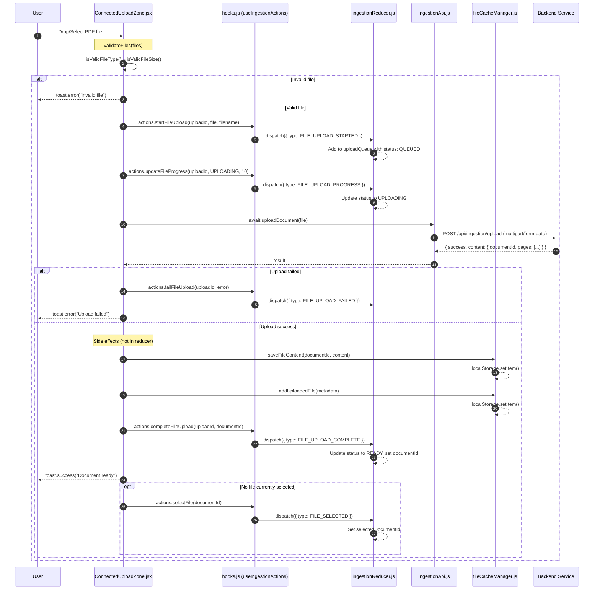

**Key Files:**
| Step | File | Function |
|------|------|----------|
| Validation | `config/ingestionConfig.js` | `isValidFileType()`, `isValidFileSize()` |
| Action Creators | `context/ingestion/hooks.js` | `useIngestionActions()` returns action methods |
| State Updates | `context/ingestion/ingestionReducer.js` | Handles `FILE_UPLOAD_*` action types |
| API Call | `services/ingestionApi.js` | `uploadDocument(file)` |
| Side Effects | `utils/fileCacheManager.js` | `saveFileContent()`, `addUploadedFile()` |

**Important:** The reducer is **pure** (no side effects). LocalStorage writes happen in the component after dispatch.

### Trigger Flow 2: Run Backend Helper 🖱️

**Trigger Type**: 🖱️ User Interaction (click helper button)

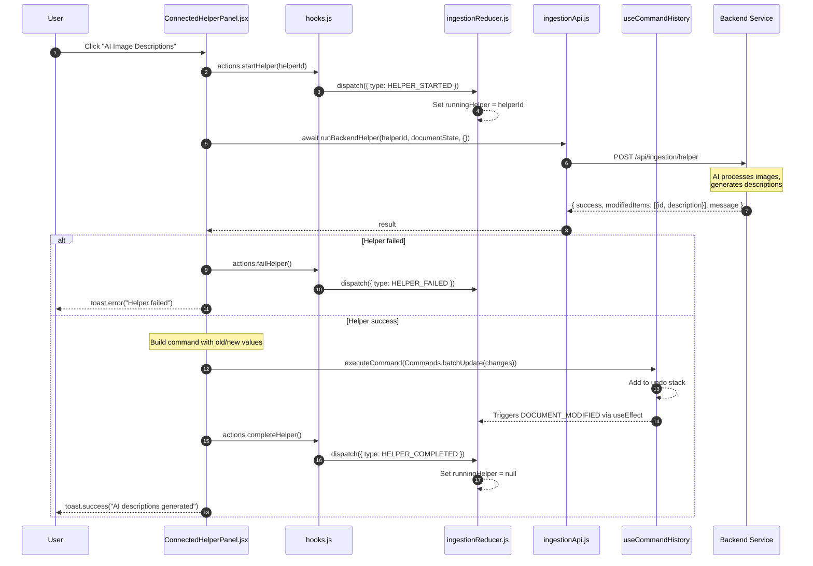

**Key Files:**
| Step | File | Function |
|------|------|----------|
| Helper Registry | `config/ingestionConfig.js` | `INGESTION_CONFIG.helpers.backend` |
| Execute Helper | `components/ingestion/ConnectedHelperPanel.jsx` | `executeHelper()` |
| API Call | `services/ingestionApi.js` | `runBackendHelper()` |
| Undo/Redo | `hooks/useCommandHistory.js` | `Commands.batchUpdate()` |

### Trigger Flow 3: Preview Embeddings 🖱️

**Trigger Type**: 🖱️ User Interaction (click "Preview Embeddings" in modal)

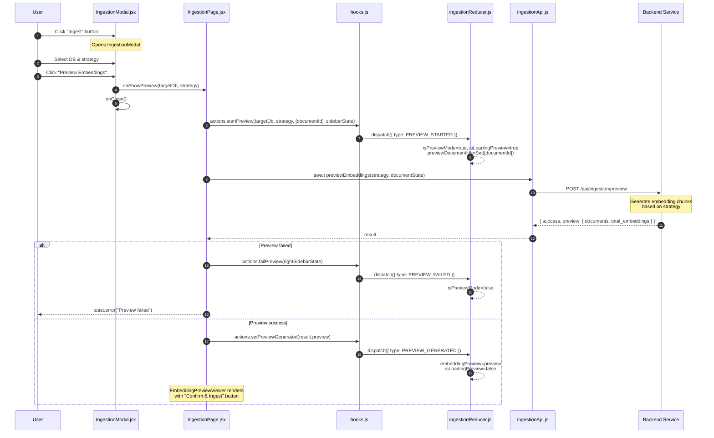

**Key Files:**
| Step | File | Function |
|------|------|----------|
| Modal UI | `components/ingestion/IngestionModal.jsx` | Strategy/DB selection |
| Orchestration | `pages/IngestionPage.jsx` | `handleShowPreview()` |
| API Call | `services/ingestionApi.js` | `previewEmbeddings()` |
| Preview Display | `components/ingestion/EmbeddingPreviewViewer.jsx` | Renders embedding cards |

### Trigger Flow 4: Confirm Ingestion 🖱️

**Trigger Type**: 🖱️ User Interaction (click "Confirm & Ingest")

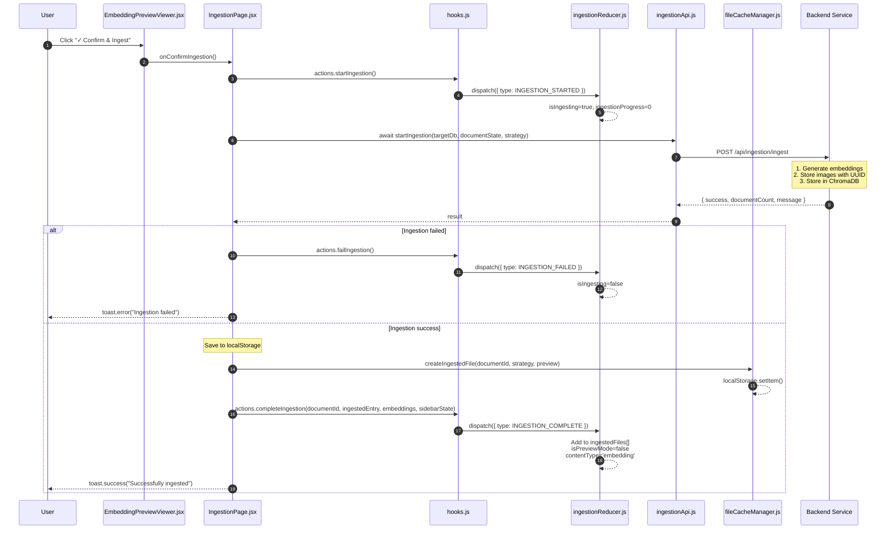

**Key Files:**
| Step | File | Function |
|------|------|----------|
| Confirm Button | `components/ingestion/EmbeddingPreviewViewer.jsx` | Triggers callback |
| Orchestration | `pages/IngestionPage.jsx` | `handleConfirmIngestion()` |
| API Call | `services/ingestionApi.js` | `startIngestion()` |
| Cache Ingested | `utils/fileCacheManager.js` | `createIngestedFile()` |

**Implementation Status**: ✅ Fully implemented

### Trigger Flow 5: Ingest All (Multi-File) 🖱️

**Trigger Type**: 🖱️ User Interaction (click "Ingest All")

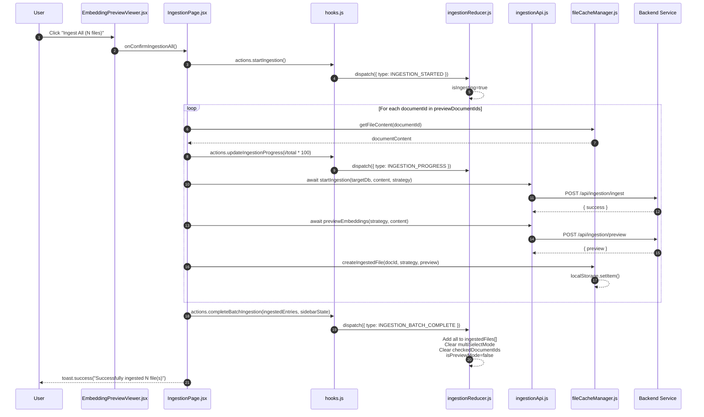

**Key Files:**
| Step | File | Function |
|------|------|----------|
| Orchestration | `pages/IngestionPage.jsx` | `handleConfirmIngestionAll()` |
| Progress Updates | `context/ingestion/hooks.js` | `actions.updateIngestionProgress()` |
| Batch Complete | `context/ingestion/ingestionReducer.js` | `INGESTION_BATCH_COMPLETE` handler |

### Trigger Flow 6: Switch Preview File 🖱️

**Trigger Type**: 🖱️ User Interaction (click different file in sidebar during preview)

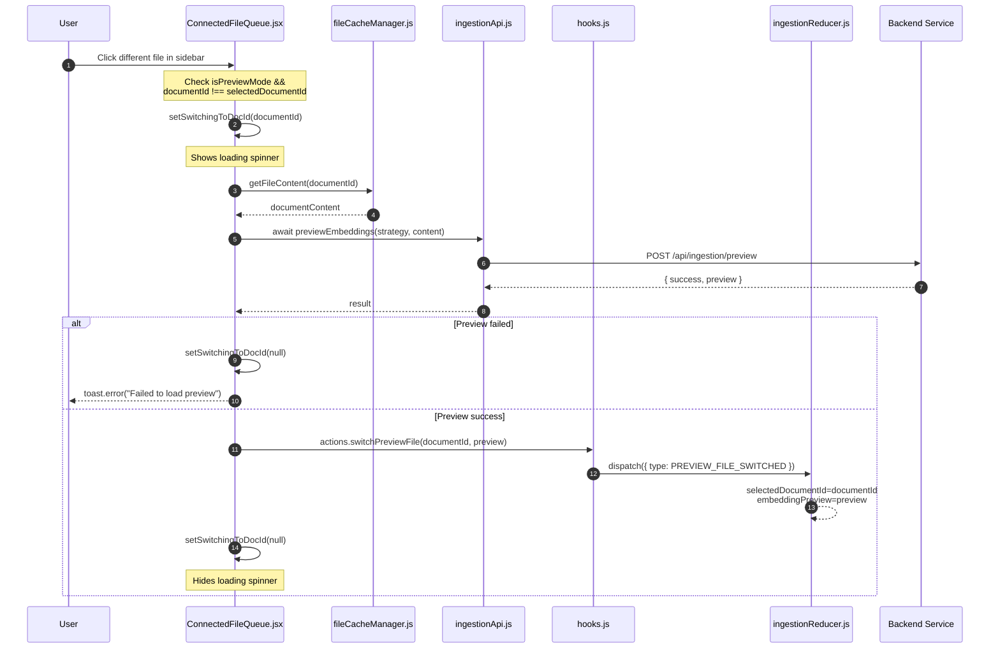

### Trigger Flow 7: Clear All Cache 🖱️

**Trigger Type**: 🖱️ User Interaction (click "Clear All" in cache management)

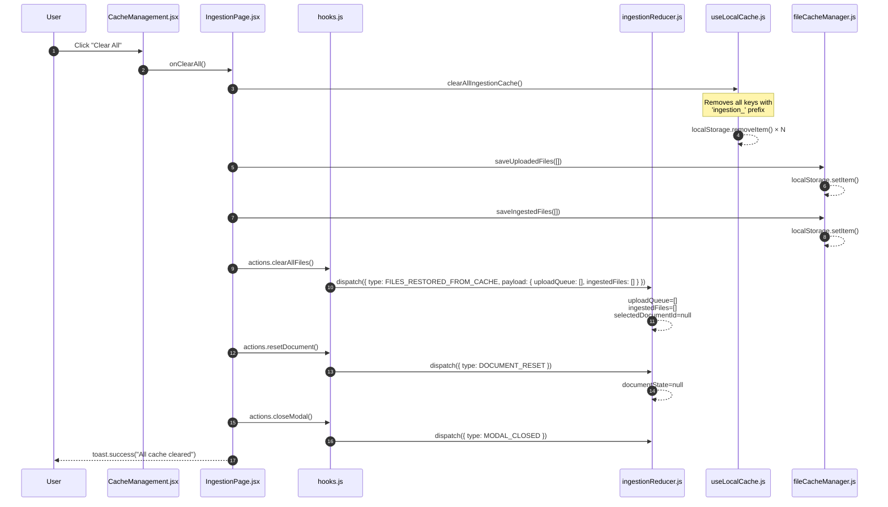

### Trigger Flow 8: Load Document on File Selection ⚡

**Trigger Type**: ⚡ State Change (`useEffect` watches `selectedDocumentId`)

This flow is triggered automatically when `selectedDocumentId` changes (after user clicks a file or after upload completes).

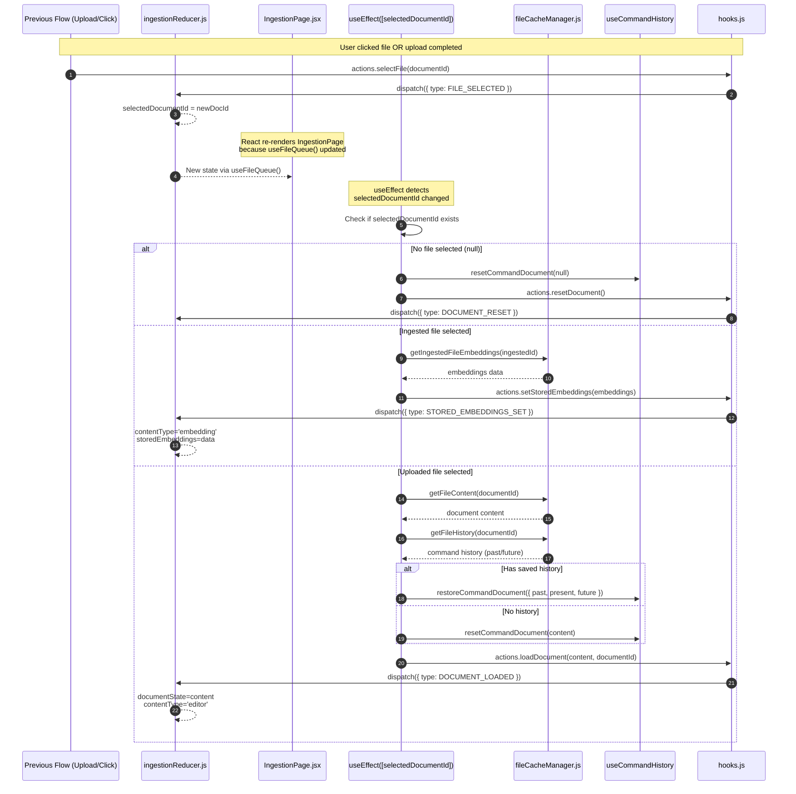

**Key Code** (from `IngestionPage.jsx`):
```javascript
// Load document content when file is selected
useEffect(() => {
    if (!selectedDocumentId) {
        resetCommandDocument(null);
        actions.resetDocument();
        return;
    }
    // ... load content based on file type
}, [selectedDocumentId, ingestedFiles, actions, resetCommandDocument, restoreCommandDocument]);
```

### Trigger Flow 9: Auto-Save Document Changes ⚡

**Trigger Type**: ⚡ State Change (`useEffect` watches `documentState`)

This flow runs automatically whenever the document content changes (after edit, delete, helper runs, etc.).

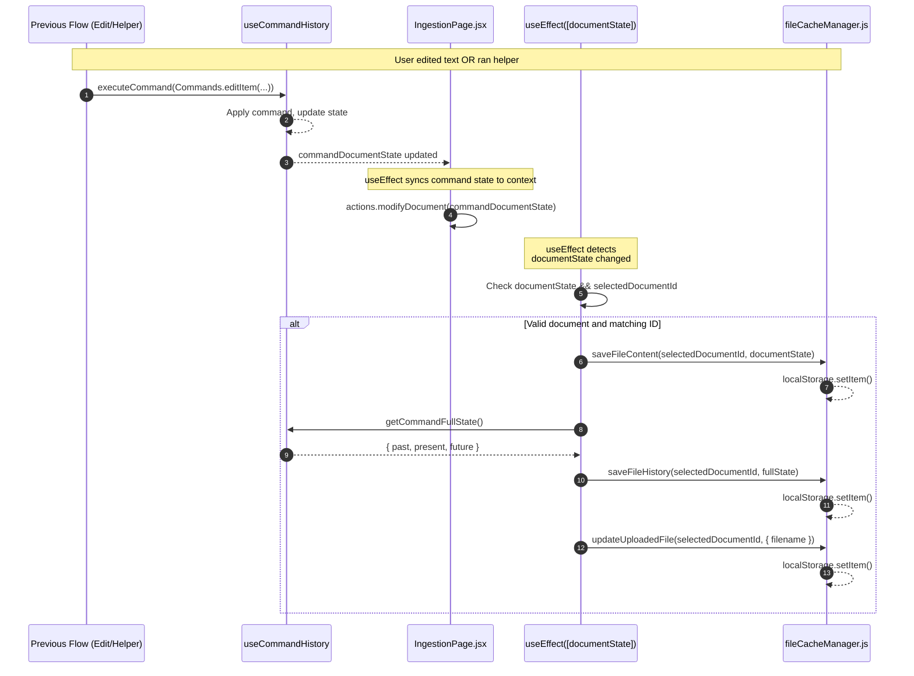

**Key Code** (from `IngestionPage.jsx`):
```javascript
// Auto-save document content and command history
useEffect(() => {
    if (documentState && selectedDocumentId && 
        commandHistoryDocIdRef.current === selectedDocumentId) {
        saveFileContent(selectedDocumentId, documentState);
        const fullState = getCommandFullState();
        saveFileHistory(selectedDocumentId, fullState);
        updateUploadedFile(selectedDocumentId, { filename: documentState.filename });
    }
}, [documentState, selectedDocumentId, getCommandFullState]);
```

### Trigger Flow 10: Sync Command History to Context ⚡

**Trigger Type**: ⚡ State Change (`useEffect` watches `commandDocumentState`)

The `useCommandHistory` hook manages its own state. This flow syncs it to the context.

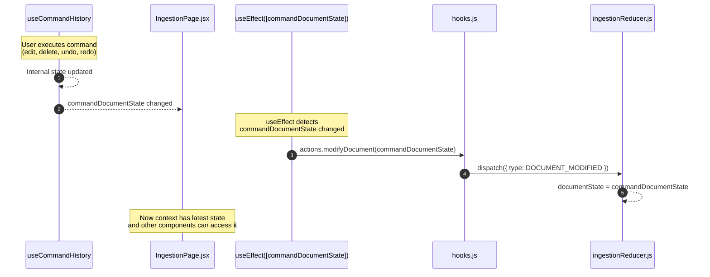

**Key Code** (from `IngestionPage.jsx`):
```javascript
// Sync command history state with context
useEffect(() => {
    if (commandDocumentState) {
        actions.modifyDocument(commandDocumentState);
    }
}, [commandDocumentState, actions]);
```

---

## Trigger Flow Summary

| Flow | Type | Trigger | Description |
|------|------|---------|-------------|
| 1. Upload Document | 🖱️ | User drops/selects file | Process and cache new document |
| 2. Run Backend Helper | 🖱️ | User clicks helper button | AI processes document content |
| 3. Preview Embeddings | 🖱️ | User clicks "Preview" | Generate embedding preview |
| 4. Confirm Ingestion | 🖱️ | User clicks "Confirm" | Store in vector database |
| 5. Ingest All | 🖱️ | User clicks "Ingest All" | Batch ingest multiple files |
| 6. Switch Preview File | 🖱️ | User clicks different file | Load different file's preview |
| 7. Clear All Cache | 🖱️ | User clicks "Clear All" | Reset all state and storage |
| 8. Load Document | ⚡ | `selectedDocumentId` changes | Load content from cache |
| 9. Auto-Save | ⚡ | `documentState` changes | Persist to localStorage |
| 10. Sync Command History | ⚡ | `commandDocumentState` changes | Sync hook state to context |

---

## Component Reference

### UploadZone.jsx
**Purpose**: Drag-drop file upload area

**Props**:
```javascript
{
  onFilesSelected: (files: FileList) => void,
  disabled: boolean,
  isDragging: boolean,
  onDragOver: (e) => void,
  onDragLeave: (e) => void,
  onDrop: (e) => void,
}
```

**Validation**: Uses `INGESTION_CONFIG.upload` for file size/type limits

---

### FileQueue.jsx
**Purpose**: Display uploaded and ingested files

**Props**:
```javascript
{
  files: Array<{documentId, filename, status}>,
  ingestedFiles: Array,
  selectedDocumentId: string,
  checkedDocumentIds: Set,
  onSelect: (documentId) => void,
  onCheck: (documentId) => void,
  multiSelectMode: boolean,
  isPreviewMode: boolean,
  previewDocumentIds: Set,
  onRemoveFromPreview: (documentId) => void,
  onRemoveFromContent: (documentId) => void,
  showIngestedSection: boolean,
}
```

**Sections**:
1. Upload Queue (active files)
2. Ingested Files (completed, green indicator)

---

### ContentViewer.jsx
**Purpose**: Main content display with page navigation

**Props**:
```javascript
{
  document: {filename, pages: [{pageNumber, items}]},
  currentPage: number,
  onPageChange: (page) => void,
  onEditItem: (itemId, newContent) => void,
  onDeleteItem: (itemId) => void,
  onRestoreItem: (itemId) => void,
  onClassChange: (itemId, newClass) => void,
  availableClasses: string[],
}
```

**Children**: `PageContent` + `PageNavigation`

---

### TextItem.jsx
**Purpose**: Editable markdown text block

**Features**:
- Click to edit (notebook-cell style)
- Markdown preview via `react-markdown`
- Auto-resize textarea
- Keyboard shortcuts: Ctrl+Enter (save), Escape (cancel)
- Soft delete with restore

**Props**:
```javascript
{
  item: {id, type: 'text', content, deleted},
  onEdit: (itemId, newContent) => void,
  onDelete: (itemId) => void,
  onRestore: (itemId) => void,
}
```

---

### ImageItem.jsx
**Purpose**: Display image with classification controls

**Features**:
- Classification badge (dropdown)
- Lightbox expand
- Auto-resize for large images
- Soft delete with restore

**Props**:
```javascript
{
  item: {id, type: 'image', imageUrl, classification, deleted, imageWidth, imageHeight},
  onDelete: (itemId) => void,
  onRestore: (itemId) => void,
  onClassChange: (itemId, newClass) => void,
  availableClasses: string[],
}
```

---

### TableItem.jsx
**Purpose**: Read-only table display

**Features**:
- Styled table with headers/rows
- Soft delete with restore

**Props**:
```javascript
{
  item: {id, type: 'table', tableData: {headers, rows}, deleted},
  onDelete: (itemId) => void,
  onRestore: (itemId) => void,
}
```

---

### HelperPanel.jsx
**Purpose**: Sidebar with helper function buttons

**Configuration**: Loaded from `INGESTION_CONFIG.helpers`

**Helper Types**:
- `local`: Execute in frontend (no backend call)
- `backend`: Require backend API call

**Props**:
```javascript
{
  onRunHelper: (helperId) => void,
  disabled: boolean,
  runningHelper: string | null,
}
```

---

### SaveBar.jsx
**Purpose**: Action bar with undo/redo/save/ingest

**Props**:
```javascript
{
  hasUnsavedChanges: boolean,
  onSave: () => void,
  canUndo: boolean,
  canRedo: boolean,
  onUndo: () => void,
  onRedo: () => void,
  onIngest: () => void,
  canIngest: boolean,
}
```

**Buttons**:
- Undo (↩️) - disabled if !canUndo
- Redo (↪️) - disabled if !canRedo
- Save - disabled if !hasUnsavedChanges
- Ingest - opens IngestionModal

---

### EmbeddingPreviewViewer.jsx
**Purpose**: Display embedding preview or stored embeddings

**Props**:
```javascript
{
  preview: {chunks: [{id, text, metadata, images}]},
  isLoading: boolean,
  onCancel: () => void,
  onConfirm: () => void,
  onConfirmAll: () => void,  // For multi-file "Ingest All"
  isMultiFile: boolean,
  totalFilesInPreview: number,
  readOnly: boolean,  // For viewing stored embeddings
}
```

**Features**:
- Paginated chunk display
- Image gallery per chunk
- Cancel/Confirm buttons (hidden in readOnly)
- "Ingest All" button for multi-file ingestion
- File switching via left sidebar click (generates new preview)

---

### IngestionModal.jsx
**Purpose**: Select target DB and ingestion strategy

**Strategies** (Hybrid Pattern - like helpers):

| Strategy | Type | Description | Status |
|----------|------|-------------|--------|
| `embed_per_page` | `local` | Merge all text per page into one chunk | ✅ Enabled |
| `chunked_fixed` | `local` | Split into fixed-size chunks (~500 tokens) | ✅ Enabled |
| `semantic_sections` | `backend` | AI detects topic boundaries (uses LLM) | 🔨 In Development |
| `hierarchical` | `backend` | Multi-level embeddings with AI summaries | ⏳ Coming Soon |

**Strategy Types**:
- `local`: Pure data transformation in frontend (no backend call)
- `backend`: Requires LLM service for AI/NLP processing

**Configuration**: Loaded from `INGESTION_CONFIG.strategies` (similar to helpers)

**Props**:
```javascript
{
  isOpen: boolean,
  onClose: () => void,
  onShowPreview: (targetDb, strategy) => void,
  backendConfig: {availableDatabases, ...},
  isIngesting: boolean,
  progress: number,
}
```

---

### CacheManagement.jsx
**Purpose**: View and clear localStorage cache

**Cache Types**:
- `editor`: Current edit state
- `uploaded`: Uploaded file metadata
- `content`: Per-file content
- `embedding`: Per-file embeddings

**Features**:
- List cached items with size
- Select individual items
- Clear selected or all

---

### HelperFileSelectModal.jsx
**Purpose**: Select files for backend helper execution

**Features**:
- Multi-select file list
- "Apply to Current File Only" shortcut
- Only shows READY files

---

## Data Flow Diagrams

### Upload to Ready Flow
```
┌──────────┐     ┌──────────┐     ┌──────────┐     ┌──────────┐
│  QUEUED  │────►│UPLOADING │────►│PROCESSING│────►│  READY   │
└──────────┘     └──────────┘     └──────────┘     └──────────┘
     │                │                 │                │
     │                │                 │                │
     ▼                ▼                 ▼                ▼
  Add to          Upload to        Backend PDF      Save to
  queue           backend          extraction      localStorage
```

### Edit to Ingest Flow
```
┌─────────────┐     ┌─────────────┐     ┌─────────────┐     ┌─────────────┐
│   EDITING   │────►│  PREVIEW    │────►│  INGESTING  │────►│  INGESTED   │
└─────────────┘     └─────────────┘     └─────────────┘     └─────────────┘
      │                   │                   │                   │
      │                   │                   │                   │
      ▼                   ▼                   ▼                   ▼
  Edit items,         Preview            Confirm &            Move to
  run helpers        embeddings          simulate           ingested list
```

### Command Pattern (Undo/Redo)
```
┌─────────────────────────────────────────────────────────┐
│                   useCommandHistory                      │
├─────────────────────────────────────────────────────────┤
│  Commands:                                              │
│  • deleteItem(itemId)     → Marks item.deleted = true   │
│  • restoreItem(itemId)    → Marks item.deleted = false  │
│  • updateItem(itemId, changes)  → Updates item props    │
│  • batchDelete([itemIds]) → Marks multiple as deleted   │
│  • batchUpdate([changes]) → Updates multiple items      │
│  • renameDocument(newName)→ Updates filename            │
├─────────────────────────────────────────────────────────┤
│  Operations:                                            │
│  • executeCommand(cmd)    → Execute and push to undo    │
│  • undo()                 → Pop from undo, push to redo │
│  • redo()                 → Pop from redo, push to undo │
│  • canUndo, canRedo       → Boolean flags               │
└─────────────────────────────────────────────────────────┘
```

---

## Quick Reference: Steps to Trigger Each Feature

### Upload a Document
1. Drag PDF file onto upload zone (or click to browse)
2. Wait for "Processing..." status
3. File appears as "Ready" in queue

### Edit Text Content
1. Select a READY file from queue
2. Click on any text block
3. Edit in textarea
4. Press Ctrl+Enter to save or Escape to cancel
5. Click "Save" in SaveBar to persist

### Delete/Restore Items
1. Hover over any item
2. Click 🗑️ Delete button
3. Item shows as "Deleted" with strikethrough
4. Click "Restore" to undo deletion
5. Or use Ctrl+Z for undo

### Run AI Helper
1. Select a READY file
2. Click "AI Image Descriptions" in right sidebar
3. Choose files in modal
4. Wait for processing
5. Images now have descriptions

### Ingest to Vector DB
1. Click "Ingest" button in SaveBar
2. Select target database
3. Choose strategy (embed_per_page or chunked_document)
4. Click "Preview"
5. Review embedding chunks
6. Click "✓ Confirm"
7. File moves to "Ingested" section

### Manage Cache
1. Click "Manage Cache" at bottom of file queue
2. Select items to clear
3. Click "Clear Selected" or "Clear All"
